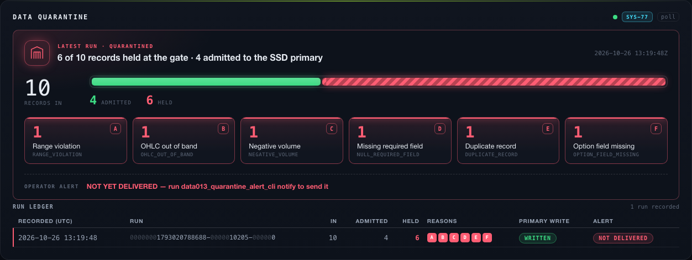
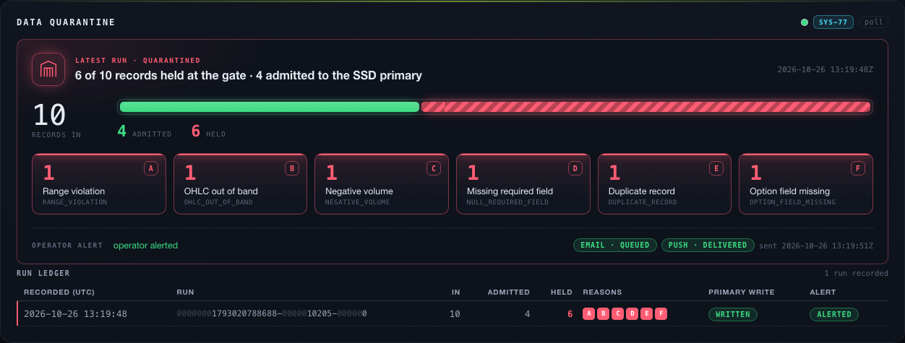

# SRS-DATA-013 — verification evidence

> Verify that validate ingested market and options records before writing to primary storage.

- **method**: `e2e`
- **steps evidenced**: 4/4
- **critics**: deterministic `approve`, judgment `approve`
- **artifacts**: 3
- **record complete**: NO

## Outstanding

- deterministic critic approved at 6f1769e2, but 1 non-evidence path(s) have changed since (docs/playbooks/test-integrity.md) — the approval describes code this close would not ship. Re-run the deterministic review.
- judgment critic approved at 6f1769e2, but 1 non-evidence path(s) have changed since (docs/playbooks/test-integrity.md) — the approval describes code this close would not ship. Re-run the judgment review.

## Acceptance criterion

> Step 3: Verify acceptance criteria: Records failing structural, range, duplicate, or required-field checks are quarantined and not written to primary tables; dashboard and notification alerts include counts and reasons.

## Steps

### Step 1

Step 1: Run ./init.sh and confirm the development environment reports Environment ready before verification begins.

`pass` · exit `0` · executed by the tool

```
./init.sh
```

<details><summary>observed output (tail)</summary>

```
→ Installing dependencies...
  Using /Users/joshgenao/Documents/Programming/Python/alphalabs-wt-SRS-DATA-013/.venv/bin/python (Python 3.13)
→ Starting dev server...
  A server is already reachable at http://127.0.0.1:3000; using it for smoke tests.
→ Waiting for server...
→ Running baseline smoke test...
→ Running contract checks (scope=env)...
→ contract checks (scope=env, 17 check(s))
  · architecture_check
  · dependency_boundary_check
  · config_check
  · startup_readiness_gate_check
  · startup_readiness_runtime_check
  · ib_adapter_check
  · rest_api_check
  · websocket_api_check
  · cli_check
  · operator_workflow_surface_check
  · operator_interface_runtime_check
  · log_record_check
  · log_persistence_check
  · subscription_fanout_check
  · sim_halt_check
  · strategy_api_indicators_check
  · strategy_api_documentation_check
✓ 17/17 contract check(s) passed (scope=env)
✓ Environment ready
```

</details>

### Step 2

Step 2: Exercise SRS-DATA-013 using CLI/API workflows with fixture market data, provider mocks, file reads, and persisted output inspection with the fixtures, mocks, or operator controls needed by the requirement.

`pass` · exit `0` · executed by the tool

```
.venv/bin/python -m pytest -q -p no:cacheprovider tests/domain/test_data013_quarantine_store.py tests/domain/test_data013_ingestion_validation.py tests/domain/test_data013_quarantine_alert.py tests/unit/test_dashboard_quarantine.py tests/boundary/test_dashboard_quarantine_wiring.py
```

<details><summary>observed output (tail)</summary>

```
........................................................................ [ 80%]
.................                                                        [100%]
89 passed in 24.73s
```

</details>

### Step 3

Step 3: Verify acceptance criteria: Records failing structural, range, duplicate, or required-field checks are quarantined and not written to primary tables; dashboard and notification alerts include counts and reasons.

`pass` · exit `0` · executed by the tool

```
.venv/bin/python -m pytest -q -p no:cacheprovider tests/e2e/test_dashboard_quarantine_browser.py
```

<details><summary>observed output (tail)</summary>

```
....                                                                     [100%]
4 passed in 13.30s
```

</details>



*quarantine pane before the alert: 6 of 10 held, one per SYS-77 rule, alert NOT YET DELIVERED*



*quarantine pane after the real notify pass: alert out on email (queued at the relay) and push (delivered)*

🎬 [full session recording](artifacts/step3-page@42548088de8670f2197d85118cd6eb1b.webm) — 1.2 MB. GitHub does not play video from a repo path; download it, or open the PR's CI artifact.


### Step 4

Step 4: Record objective evidence from test and leave passes false until the evidence proves the requirement end to end.

`pass` · exit `0` · executed by the tool

```
cargo test -p atp-data -p atp-orchestrator --test srs_data_013_ingestion_validation --test srs_data_013_quarantine_store --test srs_data_013_quarantine_alert
```

<details><summary>observed output (tail)</summary>

```
test tiered_path_records_every_reject_and_refuses_the_batch ... ok
test quarantining_path_records_its_rejects_when_a_catalog_cannot_be_read ... ok
test tiered_path_writes_nothing_when_the_run_cannot_be_recorded ... ok
test a_conflict_that_cannot_be_recorded_writes_nothing ... ok
test a_coverage_record_refuses_and_records_the_whole_batch_on_both_paths ... ok
test tiered_path_records_a_failed_primary_write_as_failed ... ok
test tiered_path_catches_a_conflict_within_the_batch_under_the_lock ... ok
test quarantining_path_persists_every_reject_with_its_reason ... ok
test a_primary_save_failure_after_a_conflict_keeps_the_conflict_recorded ... ok
test tiered_path_records_a_clean_batch_as_written ... ok
test quarantining_path_sets_aside_a_conflict_the_tier_finds_and_writes_the_rest ... ok
test tiered_path_records_a_conflicting_reingest_with_its_payload ... ok
test an_archived_key_conflict_is_caught_on_both_paths ... ok

test result: ok. 14 passed; 0 failed; 0 ignored; 0 measured; 0 filtered out; finished in 0.53s


running 15 tests
test an_unreadable_store_is_an_error_not_nothing_due ... ok
test an_unreadable_run_is_alerted_as_unreadable ... ok
test status_on_an_unreadable_store_is_an_error_not_nothing_to_report ... ok
test a_clean_run_is_not_alerted ... ok
test status_on_a_settled_run_that_became_unreadable_does_not_claim_what_it_held ... ok
test a_damaged_marker_cannot_hide_a_run ... ok
test an_alert_that_reached_no_channel_is_retried ... ok
test a_quarantine_run_is_alerted_once_with_its_count_and_nature ... ok
test status_reports_a_run_due_then_alerted_with_each_channel_outcome ... ok
test status_shows_a_failed_attempt_as_due_with_its_failures ... ok
test a_run_published_after_newer_runs_settled_is_still_alerted ... ok
test status_names_exactly_the_runs_the_next_pass_sends ... ok
test status_reports_the_same_newest_runs_as_the_summary_and_counts_them_all ... ok
test a_failed_alert_is_retried_however_many_runs_follow_it ... ok
test an_old_quarantine_run_behind_200_clean_runs_is_still_alerted ... ok

test result: ok. 15 passed; 0 failed; 0 ignored; 0 measured; 0 filtered out; finished in 19.51s

    Finished `test` profile [unoptimized + debuginfo] target(s) in 0.05s
     Running tests/srs_data_013_ingestion_validation.rs (target/debug/deps/srs_data_013_ingestion_validation-b13e2f5d025c09f0)
     Running tests/srs_data_013_quarantine_store.rs (target/debug/deps/srs_data_013_quarantine_store-8589d74cae568474)
     Running tests/srs_data_013_quarantine_alert.rs (target/debug/deps/srs_data_013_quarantine_alert-d697c02fec057047)
```

</details>

---

Generated by `tools/evidence.py render`. `passes: true` requires either every step executed by the tool with both critics approving, or a named human attestation — see `AGENTS.md`.
