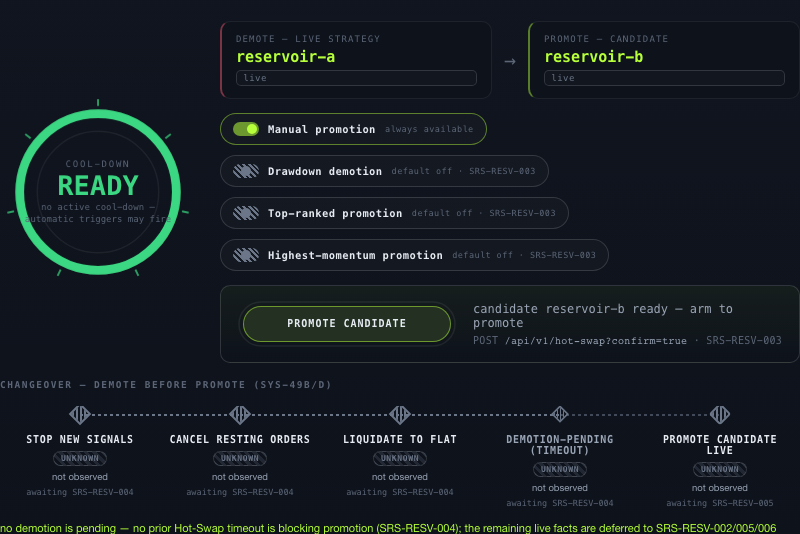
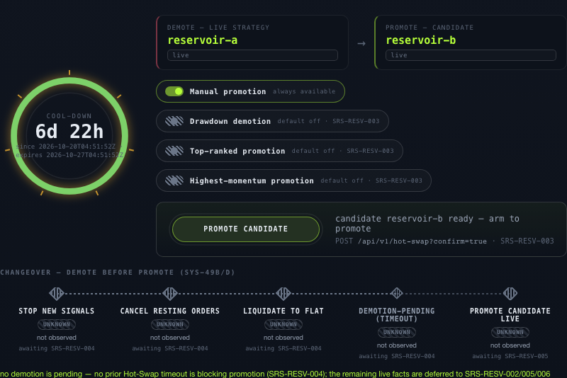
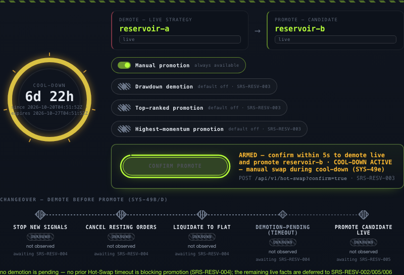
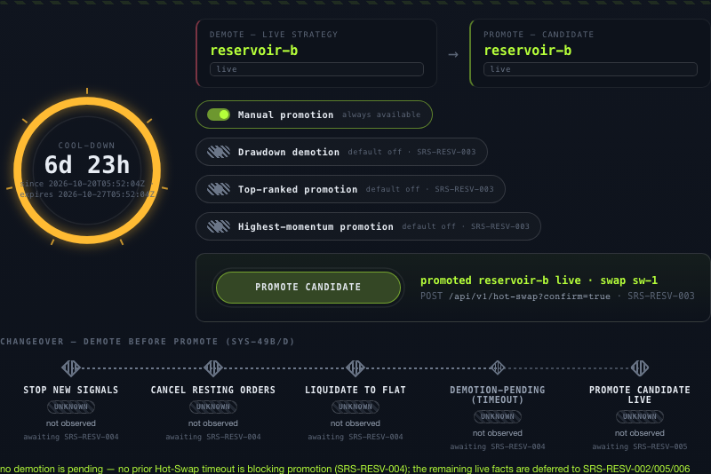
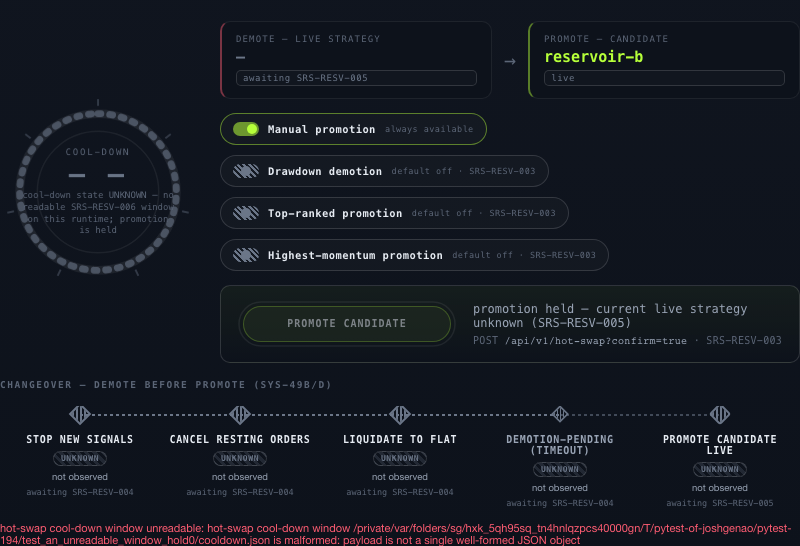
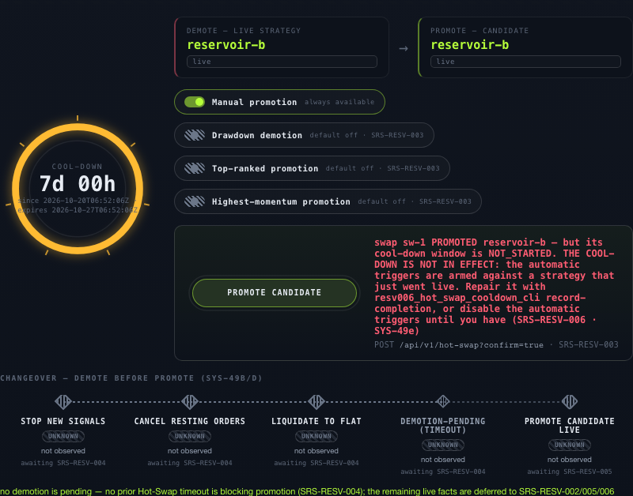

# SRS-RESV-006 — verification evidence

> Verify that enforce Hot-Swap cool-down behavior.

- **method**: `e2e`
- **steps evidenced**: 4/4
- **critics**: deterministic `approve`, judgment `block`
- **artifacts**: 9
- **record complete**: NO

## Outstanding

- deterministic critic approved at 3f0afcf9, but 252 non-evidence path(s) have changed since (.env.example, .github/workflows/security.yml, .gitleaks.toml…) — the approval describes code this close would not ship. Re-run the deterministic review.
- judgment critic verdict is 'block', not 'approve'
- verification_method is 'e2e' but no image artifact is attached to step 3 — its acceptance criterion is about what a reviewer can SEE. Attach one: `tools/evidence.py artifact SRS-RESV-006 --step 3 --file <screenshot.png> --caption '...'`

## Acceptance criterion

> Step 3: Verify acceptance criteria: After successful swap, automatic triggers are ignored for the configured cool-down period defaulting to 7 calendar days; manual swap during cool-down requires confirmation warning; the cool-down start time is the timestamp of the most recent successful swap completion.

## Steps

### Step 1

Step 1: Run ./init.sh and confirm the development environment reports Environment ready before verification begins.

`pass` · exit `0` · executed by the tool

```
./init.sh
```

<details><summary>observed output (tail)</summary>

```
→ Installing dependencies...
  Using /Users/joshgenao/Documents/Programming/Python/alphalabs-wt-SRS-RESV-006/.venv/bin/python (Python 3.13)
→ Starting dev server...
  A server is already reachable at http://127.0.0.1:3000; using it for smoke tests.
→ Waiting for server...
→ Running baseline smoke test...
→ Running contract checks (scope=env)...
→ contract checks (scope=env, 17 check(s))
  · architecture_check
  · dependency_boundary_check
  · config_check
  · startup_readiness_gate_check
  · startup_readiness_runtime_check
  · ib_adapter_check
  · rest_api_check
  · websocket_api_check
  · cli_check
  · operator_workflow_surface_check
  · operator_interface_runtime_check
  · log_record_check
  · log_persistence_check
  · subscription_fanout_check
  · sim_halt_check
  · strategy_api_indicators_check
  · strategy_api_documentation_check
✓ 17/17 contract check(s) passed (scope=env)
✓ Environment ready
```

</details>

### Step 2

Step 2: Exercise SRS-RESV-006 using browser automation against the dashboard plus REST or WebSocket checks where applicable with the fixtures, mocks, or operator controls needed by the requirement.

`pass` · exit `0` · executed by the tool

```
.venv/bin/python -m pytest tests/e2e/test_hot_swap_cooldown_browser.py -q
```

<details><summary>observed output (tail)</summary>

```
...                                                                      [100%]
3 passed in 20.42s
```

</details>



*Hot-Swap pane with no cool-down window: the dial reads READY and the promote control is armable (SYS-49e clause 1, baseline)*



*A recorded swap completion opens the SYS-49e window: the dial reads ACTIVE with the remaining time counted from the completion timestamp (clause 1, and clause 3's start time)*



*Arming during the cool-down raises SYS-49e's confirmation warning — the manual swap is offered, not blocked (clause 2)*



*After the confirmed swap: the window has RESTARTED at the new swap's own completion timestamp, so the countdown is back to nearly seven days (clause 3 — the start time is the most recent successful completion)*

🎬 [full session recording](artifacts/step2-page@6b2496e658c0e3ee2aa5dc76b2d91d3e.webm) — 1.0 MB. GitHub does not play video from a repo path; download it, or open the PR's CI artifact.



*A corrupt cool-down window: the dial reports UNKNOWN and the promote control is held inert — an unreadable window is never read as 'clear'*

🎬 [full session recording](artifacts/step2-page@07883e079322b66600f63764b82c16f4.webm) — 0.3 MB. GitHub does not play video from a repo path; download it, or open the PR's CI artifact.



*A swap that PROMOTED but could not open its SYS-49e window: the pane says the candidate is live AND that nothing is suppressing the automatic triggers, and names the repair command (adversarial review r24)*

🎬 [full session recording](artifacts/step2-page@aa65b4ddd729d5fb478f6a2e2cece0ad.webm) — 0.6 MB. GitHub does not play video from a repo path; download it, or open the PR's CI artifact.


### Step 3

Step 3: Verify acceptance criteria: After successful swap, automatic triggers are ignored for the configured cool-down period defaulting to 7 calendar days; manual swap during cool-down requires confirmation warning; the cool-down start time is the timestamp of the most recent successful swap completion.

`pass` · exit `0` · executed by the tool

```
.venv/bin/python -m pytest tests/domain/test_hot_swap_cooldown.py -q
```

<details><summary>observed output (tail)</summary>

```
................................................                         [100%]
48 passed in 2.60s
```

</details>

### Step 4

Step 4: Record objective evidence from test and leave passes false until the evidence proves the requirement end to end.

`pass` · exit `0` · executed by the tool

```
cargo test -p atp-orchestrator
```

<details><summary>observed output (tail)</summary>

```
ch_4_deployment_version_contract.rs (target/debug/deps/orch_4_deployment_version_contract-49e33f2c72078469)
     Running tests/orch_5_cli_fail_closed.rs (target/debug/deps/orch_5_cli_fail_closed-1cc54cb468a12381)
     Running tests/orch_5_rollback_contract.rs (target/debug/deps/orch_5_rollback_contract-40a9be3aeb6c41f4)
     Running tests/resv_3_cli_fail_closed.rs (target/debug/deps/resv_3_cli_fail_closed-cf0a52b8d2b3e087)
resv003_hot_swap_trigger_cli: SRS-RESV-006: manual Hot-Swap requires confirmation during a cool-down (window UNKNOWN): the Hot-Swap cool-down window could not be determined, so this build cannot say whether a swap is within one (SyRS SYS-49e): no cool-down state path configured (--cooldown-state); this build cannot say whether a Hot-Swap cool-down is in effect. Confirm to swap manually anyway.
resv003_hot_swap_trigger_cli: degraded input port(s): hot-swap cool-down state: no cool-down state path configured (--cooldown-state); this build cannot say whether a Hot-Swap cool-down is in effect (fail closed)
resv003_hot_swap_trigger_cli: SRS-RESV-006: manual Hot-Swap requires confirmation during a cool-down (window UNKNOWN): the Hot-Swap cool-down window could not be determined, so this build cannot say whether a swap is within one (SyRS SYS-49e): no cool-down state path configured (--cooldown-state); this build cannot say whether a Hot-Swap cool-down is in effect. Confirm to swap manually anyway.
resv003_hot_swap_trigger_cli: degraded input port(s): hot-swap cool-down state: no cool-down state path configured (--cooldown-state); this build cannot say whether a Hot-Swap cool-down is in effect (fail closed)
     Running tests/resv_3_hot_swap_triggers.rs (target/debug/deps/resv_3_hot_swap_triggers-e7b8aee8148acde3)
     Running tests/resv_3_trigger_log_schema.rs (target/debug/deps/resv_3_trigger_log_schema-f4f66c11369151b5)
     Running tests/resv_4_demotion_pending_store.rs (target/debug/deps/resv_4_demotion_pending_store-4a213a201c27ae7c)
     Running tests/resv_4_demotion_sequence.rs (target/debug/deps/resv_4_demotion_sequence-96e1a838f7076f82)
     Running tests/resv_5_hot_swap_promotion.rs (target/debug/deps/resv_5_hot_swap_promotion-8962ac891fb610e0)
     Running tests/resv_6_cli_fail_closed.rs (target/debug/deps/resv_6_cli_fail_closed-930e6d8e89acae9f)
     Running tests/resv_6_cooldown_classification.rs (target/debug/deps/resv_6_cooldown_classification-575984fe9db5d008)
     Running tests/resv_6_cooldown_execution.rs (target/debug/deps/resv_6_cooldown_execution-6e5bd2c8a44707f3)
     Running tests/resv_6_cooldown_gate.rs (target/debug/deps/resv_6_cooldown_gate-064bc48c605047ac)
     Running tests/resv_6_cooldown_relative_path.rs (target/debug/deps/resv_6_cooldown_relative_path-60bd21efb09976b9)
     Running tests/resv_6_cooldown_store.rs (target/debug/deps/resv_6_cooldown_store-7f139eb0800ccc03)
     Running tests/safe_002_liquidation_timeout_scenario.rs (target/debug/deps/safe_002_liquidation_timeout_scenario-33573d8651afcd69)
     Running tests/srs_data_013_quarantine_alert.rs (target/debug/deps/srs_data_013_quarantine_alert-d697c02fec057047)
     Running tests/srs_err_001_broker_envelope_cli.rs (target/debug/deps/srs_err_001_broker_envelope_cli-ddb4d4118daf4d39)
     Running tests/srs_err_001_broker_envelope_live.rs (target/debug/deps/srs_err_001_broker_envelope_live-7d5e08710aacd6c3)
     Running tests/srs_exe_001_live_host.rs (target/debug/deps/srs_exe_001_live_host-7c593315c75d2d2b)
     Running tests/srs_exe_002_routing_wiring.rs (target/debug/deps/srs_exe_002_routing_wiring-45daa4de785d00f1)
     Running tests/srs_md_005_restart_window_cli.rs (target/debug/deps/srs_md_005_restart_window_cli-ea35429f112f017c)
     Running tests/srs_safe_003_connectivity_block_cli.rs (target/debug/deps/srs_safe_003_connectivity_block_cli-8f513f0cd08c627b)
     Running tests/srs_safe_003_connectivity_block_wiring.rs (target/debug/deps/srs_safe_003_connectivity_block_wiring-a646effc5e9c4dc1)
   Doc-tests atp_orchestrator
```

</details>

---

Generated by `tools/evidence.py render`. `passes: true` requires either every step executed by the tool with both critics approving, or a named human attestation — see `AGENTS.md`.
